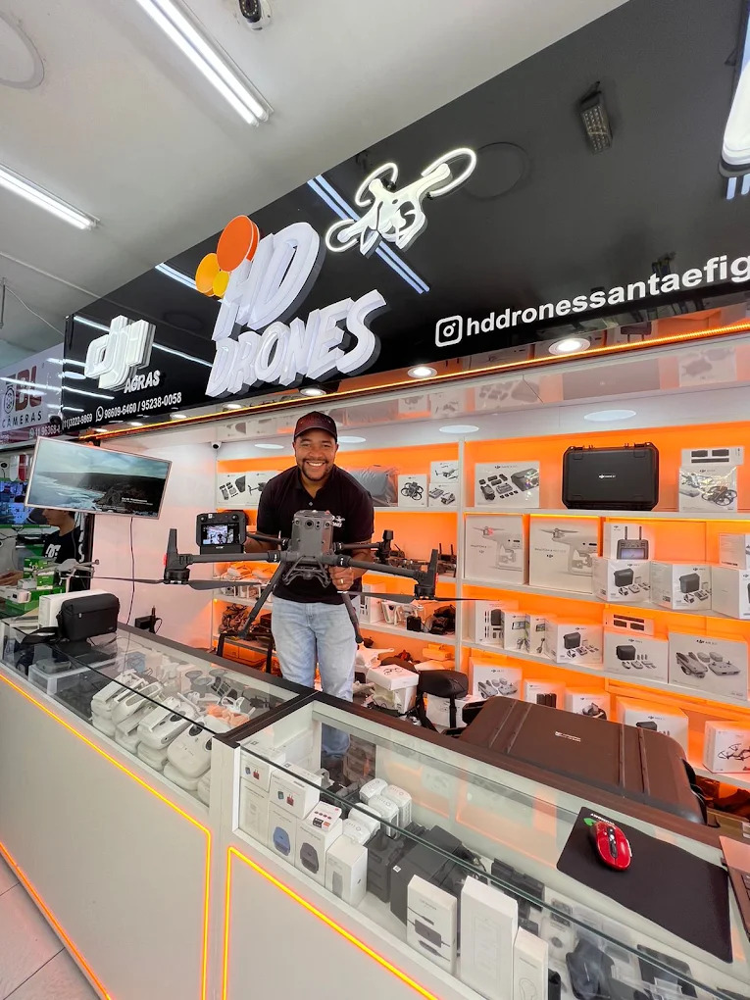

# Entrega 2 — Relatório Técnico Final
### Modelagem Lógica, Normalização e Banco de Dados Relacional para a HD Drones

---

## Metadados (Integrantes)

| Nome completo do aluno | RGM | Usuário do GitHub |
| :--- | :--- | :--- |
| Adriano Salviano Marcal | 48188697 | [@adrianomarccal](https://github.com/adrianomarccal) |
| Arthur Tigre Francisco | 48201413 | [@tigrea021-ai](https://github.com/tigrea021-ai) |
| Gabriel de Oliveira Silva | 48203068 | [@Gabriel-Olvr](https://github.com/Gabriel-Olvr) |
| Gabriel Marcolino de Oliveira | 48226718 | [@gabrielmarcolinooo](https://github.com/gabrielmarcolinooo) |
| Giovanni dos Santos Silva | 48159077 | [@giovannisantos458-netizen](https://github.com/giovannisantos458-netizen) |

---

##  Sumário / Índice do Documento

1. [Caracterização da Organização e Revisão Conceitual](#1-caracterização-da-organização-e-revisão-conceitual)
   - [Tabela de Ajustes da E1 para a E2 (Caso A)](#-tabela-de-ajustes-da-entrega-1-para-a-entrega-2-caso-a)
2. [Processos de Negócio Mapeados](#2-processos-de-negócio-mapeados)
3. [Requisitos do Sistema](#3-requisitos-do-sistema)
   - [3.1 Requisitos Funcionais](#31-requisitos-funcionais)
   - [3.2 Requisitos Não Funcionais](#32-requisitos-não-funcionais)
4. [Regras de Negócio](#4-regras-de-negócio)
5. [Dicionário de Dados Lógico (Resumo de Tabelas)](#5-dicionário-de-dados-lógico-resumo-de-tabelas)
6. [Modelagem Lógica e Mapeamento de Relações](#6-modelagem-lógica-e-mapeamento-de-relações)
7. [Diagrama Lógico do Banco de Dados](#7-diagrama-lógico-do-banco-de-dados)
8. [Justificativas Técnicas, Normalização e Modelo Lógico](#8-justificativas-técnicas-normalização-e-modelo-lógico)
   - [8.1 Processo de Normalização (1FN, 2FN e 3FN)](#81-processo-de-normalização-1fn-2fn-e-3fn)
   - [8.2 Escolha do Mecanismo InnoDB](#82-escolha-do-mecanismo-innodb)
9. [Arquitetura Analítica (KPIs e Tabela de Rastreabilidade)](#9-arquitetura-analítica-kpis-e-tabela-de-rastreabilidade)
10. [Massa de Dados e Justificativa de Volume](#10-massa-de-dados-e-justificativa-de-volume)
11. [Transparência no Uso de Inteligência Artificial](#11-transparência-no-uso-de-inteligência-artificial)
12. [Instruções de Execução do Script SQL](#12-instruções-de-execução-do-script-sql)

---

## 1. Caracterização da Organização e Revisão Conceitual

- **Nome e natureza da organização:** HD Drones — Comércio e Assistência Técnica de Drones e Acessórios LTDA. Empresa comercial e de serviços de pequeno porte (Sociedade Empresária Limitada).
- **Contexto e porte:** Organização comercial e de serviços atuando na venda de drones novos/seminovos, peças de reposição, acessórios e serviços de manutenção/ordens de serviço. Conta com equipe enxuta composta por 8 colaboradores diretos: 1 gestor proprietário, 3 vendedores de balcão, 3 técnicos de assistência e 1 Atendente de Balcão. Operação diária média de 15 a 25 atendimentos de balcão e 5 a 10 entradas de aparelhos para orçamento e reparo, mantendo um catálogo ativo de cerca de 150 a 300 produtos/peças em estoque.
- **Problemas e necessidades identificados:**
  - **`P1` — Divergência no Saldo de Estoque e Perda de Rastreabilidade:** Ausência de controle automatizado de entradas via fornecedores e saídas físicas de peças utilizadas na assistência técnica.
  - **`P2` — Ausência de Controle Formal de Ordens de Serviço (OS):** Dificuldade no acompanhamento dos estágios de manutenção (orçamento, aprovação, execução, mão de obra e garantia).
  - **`P3` — Incerteza Financeira na Apuração de Margens e Comissões:** Dificuldade no cálculo do lucro líquido real por transação e apuração de comissões por colaborador.
  - **`P4` — Falta de Auditoria de Compras e Histórico de Preços:** Ausência de registro imutável de movimentações de estoque, fornecedores e histórico de alterações de preços.
- **Justificativa da escolha:** A HD Drones é uma empresa real e ativa com acesso direto garantido para pesquisa de campo, entrevistas operacionais e mapeamento de processos.
- **Evidências da organização:**
  - **Endereço Completo:** Rua Santa Ifigênia, 480, Loja 22 — Centro Histórico de São Paulo, São Paulo - SP, CEP: 01207-000.
  - **Forma de Contato:** Telefone/WhatsApp empresarial: (11) 98609-6460 | E-mail: contato@hddrones.com.br.
  - **Perfil no Google:** [Google Maps — HD Drones Santa Ifigênia](https://maps.app.goo.gl/kXECRvr7fZs1BGMM7)
  - **Atividades e Acesso de Campo:** O integrante do grupo Gabriel de Oliveira Silva trabalhava na própria organização, o que garantiu mais facilmente o acesso direto e diário ao proprietário que tem acesso às rotinas operacionais, ao fluxo do caixa (PDV) e ao levantamento das ordens de serviço (OS).
  - **Comprovação Visual do Local:**

  - **Comprovação de contato com o proprietário:**

  

###  Tabela de Ajustes da Entrega 1 para a Entrega 2 (Caso A)

| Apontamento da Correção da E1 | O que mudou no trabalho | Por quê |
| :--- | :--- | :--- |
| **Fusão incorreta da OS em Vendas** | Desmembrada a estrutura: criada a tabela `Ordem_Servico` separada de `Vendas`, com a tabela associativa `Pecas_OS`. | Para permitir o registro de OS em andamento, orçamento, aparelho, defeito, mão de obra e peças aplicadas. |
| **Ausência do Ciclo de Compras/Fornecedores** | Adicionada a tabela `Fornecedores` relacionando-se com `Movimentacoes_Estoque`. | Para garantir a rastreabilidade da origem dos produtos adquiridos pela loja. |
| **Falta de Comprovação Visual no README** | Renderizada a imagem da fachada da loja no `README.md` e incluído endereço completo com número e CEP. | Para validar a existência real da organização e eliminar os fatores multiplicadores de penalidade. |
| **Erros Notacionais e Tipos no Dicionário** | Atualizados os tipos monetários para `DECIMAL(10,2)` e padronizados os nomes das colunas entre o dicionário e o SQL. | Para garantir conformidade com o modelo relacional no MySQL 8. |

---

## 2. Processos de Negócio Mapeados

- **`PR01` — Cadastro e Gestão de Clientes e Fornecedores:** Captação de dados cadastrais fiscais e essenciais (`nome_razao`, `cpf_cnpj`, `telefone`, `email`, `endereco`) de clientes e fornecedores para compras e histórico comercial.
- **`PR02` — Venda de Balcão (PDV):** Seleção de produtos, baixa de saldo em estoque, cálculo de comissão do vendedor e congelamento de preços praticados nas tabelas associativas.
- **`PR03` — Abertura, Execução e Garantia de Ordem de Serviço (OS):** Registro de assistência técnica vinculando obrigatoriamente um cliente, detalhando defeito, aprovação de orçamento, valor da mão de obra, baixa automática de peças utilizadas (`Pecas_OS`) e prazo legal de garantia (CDC).
- **`PR04` — Ciclo de Compras e Controle de Inventário:** Registro de entrada de mercadorias via fornecedores, ajustes de inventário e auditoria de movimentações (`Movimentacoes_Estoque`).
- **`PR05` — Apoio, Margens e Comissões:** Apuração do faturamento bruto, lucro líquido por operação e relatório consolidado de comissões por colaborador.

---

## 3. Requisitos do Sistema

### 3.1 Requisitos Funcionais

- **`RF01`:** O sistema deve permitir o cadastro de clientes e fornecedores com identificador único de CPF ou CNPJ (`UNIQUE`).
- **`RF02`:** O sistema deve permitir a associação opcional de cliente nas vendas de balcão (`PR02`), mas **exigir obrigatoriamente** o vínculo de um cliente cadastrado ao abrir uma Ordem de Serviço (`PR03`).
- **`RF03`:** O sistema deve registrar vendas e ordens de serviço associando-as ao funcionário responsável, calculando a respectiva comissão sobre a transação.
- **`RF04`:** O sistema deve dar baixa automática no estoque de produtos e peças a cada item vendido (`Compoe_Venda`) ou utilizado em ordens de serviço (`Pecas_OS`).
- **`RF05`:** O sistema deve congelar o preço de custo e venda dos itens no momento da transação e registrar prazos de garantia legais (CDC) para serviços concluídos.
- **`RF06`:** O sistema deve registrar entradas de compras associadas aos respectivos fornecedores (`Fornecedores`).
- **`RF07`:** O sistema deve manter histórico auditável imutável de movimentações físicas de estoque (`Movimentacoes_Estoque`).

### 3.2 Requisitos Não Funcionais

- **`RNF01` (Desempenho):** As consultas de saldo de estoque e busca de clientes devem responder em tempo inferior a 2 segundos.
- **`RNF02` (Integridade Referencial):** O SGBD deve garantir a consistência das chaves estrangeiras (`FK`), impedindo a exclusão acidental de clientes, fornecedores ou produtos com registros vinculados (`ON DELETE RESTRICT`).
- **`RNF03` (Usabilidade e Concorrência):** A interface deve permitir transações simultâneas em ambiente multiusuário garantindo suporte a propriedades ACID através do mecanismo InnoDB no MySQL 8.

---

## 4. Regras de Negócio

- **`RN01` (Unicidade de Identificação):** O mesmo CPF ou CNPJ não pode ser cadastrado em duplicidade (`UNIQUE`).
- **`RN02` (Congelamento Financeiro):** Os preços e custos aplicados em vendas e OS são salvos nas tabelas associativas (`Compoe_Venda` e `Pecas_OS`) no momento da operação para preservar o histórico financeiro.
- **`RN03` (Opcionalidade vs. Obrigatoriedade de Cliente):** Vendas de balcão permitem cliente nulo/opcional; Ordens de Serviço exigem cliente cadastrado.
- **`RN04` (Garantia Legal CDC):** Toda Ordem de Serviço entregue gera automaticamente uma cobertura de garantia padrão de 90 dias.
- **`RN05` (Atribuição de Comissões):** Cada funcionário possui atribuição de vendas/OS registradas por ele para cálculo de comissões.

---

## 5. Dicionário de Dados Lógico (Resumo de Tabelas)

### Tabela: `Clientes`
| Coluna | Tipo de Dado | Restrições | Descrição |
| --- | --- | --- | --- |
| `id` | `INT` | `PK`, `AUTO_INCREMENT` | Identificador único do cliente. |
| `nome_razao` | `VARCHAR(150)` | `NOT NULL` | Nome completo ou Razão Social. |
| `cpf_cnpj` | `VARCHAR(20)` | `NOT NULL`, `UNIQUE` | Documento fiscal do cliente. |
| `telefone` | `VARCHAR(20)` | `NOT NULL` | Telefone ou WhatsApp para contato. |
| `email` | `VARCHAR(100)` | Opcional | E-mail de contato. |
| `endereco` | `VARCHAR(255)` | Opcional | Endereço residencial ou comercial. |

### Tabela: `Fornecedores`
| Coluna | Tipo de Dado | Restrições | Descrição |
| --- | --- | --- | --- |
| `id` | `INT` | `PK`, `AUTO_INCREMENT` | Identificador único do fornecedor. |
| `razao_social` | `VARCHAR(150)` | `NOT NULL` | Razão Social da empresa fornecedora. |
| `cnpj` | `VARCHAR(20)` | `NOT NULL`, `UNIQUE` | CNPJ do fornecedor. |
| `telefone` | `VARCHAR(20)` | `NOT NULL` | Telefone de contato comercial. |
| `email` | `VARCHAR(100)` | Opcional | E-mail de contato comercial. |

### Tabela: `Funcionario`
| Coluna | Tipo de Dado | Restrições | Descrição |
| --- | --- | --- | --- |
| `id` | `INT` | `PK`, `AUTO_INCREMENT` | Identificador do colaborador. |
| `nome` | `VARCHAR(100)` | `NOT NULL` | Nome do colaborador. |
| `cargo` | `VARCHAR(50)` | `NOT NULL` | Função exercida na empresa. |

### Tabela: `Produtos`
| Coluna | Tipo de Dado | Restrições | Descrição |
| --- | --- | --- | --- |
| `id` | `INT` | `PK`, `AUTO_INCREMENT` | Identificador do produto/peça. |
| `nome` | `VARCHAR(150)` | `NOT NULL` | Descrição comercial do produto. |
| `categoria` | `ENUM` | `NOT NULL` | 'Drones', 'Baterias', 'Acessórios', 'Peças'. |
| `preco_venda` | `DECIMAL(10,2)` | `NOT NULL` | Preço de tabela para venda. |
| `preco_custo` | `DECIMAL(10,2)` | `NOT NULL` | Preço de aquisição do item. |
| `quantidade_estoque` | `INT` | Valor padrão `0` | Saldo físico em estoque. |

### Tabela: `Vendas`
| Coluna | Tipo de Dado | Restrições | Descrição |
| --- | --- | --- | --- |
| `id` | `INT` | `PK`, `AUTO_INCREMENT` | Identificador único da venda de balcão. |
| `data_hora` | `DATETIME` | `DEFAULT CURRENT_TIMESTAMP` | Carimbo de data/hora da transação. |
| `valor_total` | `DECIMAL(10,2)` | `DEFAULT 0.00` | Valor bruto da transação. |
| `lucro_total` | `DECIMAL(10,2)` | `DEFAULT 0.00` | Lucro líquido obtido. |
| `forma_pagamento` | `ENUM` | `NOT NULL` | 'Pix', 'Dinheiro', 'Cartão de Crédito', 'Cartão de Débito'. |
| `id_cliente` | `INT` | `FK` (Clientes), Opcional | Cliente vinculado à venda. |
| `id_funcionario` | `INT` | `FK` (Funcionario), `NOT NULL` | Vendedor responsável. |

### Tabela: `Compoe_Venda`
| Coluna | Tipo de Dado | Restrições | Descrição |
| --- | --- | --- | --- |
| `id_venda` | `INT` | `PK`, `FK` (Vendas) | Referência à venda. |
| `id_produto` | `INT` | `PK`, `FK` (Produtos) | Referência ao produto. |
| `quantidade` | `INT` | `NOT NULL`, `CHECK(>0)` | Quantidade vendida. |
| `preco_unitario_aplicado` | `DECIMAL(10,2)` | `NOT NULL` | Preço congelado na venda. |
| `preco_custo_aplicado` | `DECIMAL(10,2)` | `NOT NULL` | Custo congelado na venda. |

### Tabela: `Ordem_Servico`
| Coluna | Tipo de Dado | Restrições | Descrição |
| --- | --- | --- | --- |
| `id` | `INT` | `PK`, `AUTO_INCREMENT` | Identificador da Ordem de Serviço. |
| `aparelho_drone` | `VARCHAR(100)` | `NOT NULL` | Modelo do equipamento recebido. |
| `defeito_relatado` | `TEXT` | `NOT NULL` | Descrição do problema pelo cliente. |
| `status` | `ENUM` | Default 'Orçamento' | 'Orçamento', 'Aprovado', 'Em Manutenção', 'Concluído', 'Entregue com Garantia', 'Cancelado'. |
| `valor_mao_obra` | `DECIMAL(10,2)` | `DEFAULT 0.00` | Valor cobrado pela mão de obra. |
| `valor_pecas` | `DECIMAL(10,2)` | `DEFAULT 0.00` | Soma das peças aplicadas no conserto. |
| `valor_total` | `DECIMAL(10,2)` | `DEFAULT 0.00` | Valor total da OS (`mao_obra + pecas`). |
| `data_abertura` | `DATETIME` | `DEFAULT CURRENT_TIMESTAMP` | Data de entrada do aparelho. |
| `data_conclusao` | `DATETIME` | Opcional | Data de finalização/entrega. |
| `prazo_garantia_dias` | `INT` | Default `90` | Período legal de garantia (CDC). |
| `id_cliente` | `INT` | `FK` (Clientes), `NOT NULL` | Cliente proprietário do equipamento. |
| `id_tecnico` | `INT` | `FK` (Funcionario), `NOT NULL` | Técnico responsável pela manutenção. |

### Tabela: `Pecas_OS`
| Coluna | Tipo de Dado | Restrições | Descrição |
| --- | --- | --- | --- |
| `id_os` | `INT` | `PK`, `FK` (Ordem_Servico) | Referência à Ordem de Serviço. |
| `id_produto` | `INT` | `PK`, `FK` (Produtos) | Referência à peça em estoque. |
| `quantidade` | `INT` | `NOT NULL`, `CHECK(>0)` | Quantidade de peças utilizadas. |
| `preco_unitario_aplicado` | `DECIMAL(10,2)` | `NOT NULL` | Preço da peça congelado na OS. |

### Tabela: `Movimentacoes_Estoque`
| Coluna | Tipo de Dado | Restrições | Descrição |
| --- | --- | --- | --- |
| `id` | `INT` | `PK`, `AUTO_INCREMENT` | Identificador da movimentação. |
| `id_produto` | `INT` | `FK` (Produtos), `NOT NULL` | Produto movimentado. |
| `id_funcionario` | `INT` | `FK` (Funcionario), `NOT NULL` | Colaborador responsável. |
| `id_fornecedor` | `INT` | `FK` (Fornecedores), Opcional | Fornecedor de origem (compras). |
| `quantidade_mov` | `INT` | `NOT NULL` | Saldo movimentado. |
| `observacao` | `VARCHAR(255)` | Opcional | Descrição do lançamento. |
| `data_movimentacao` | `DATETIME` | `DEFAULT CURRENT_TIMESTAMP` | Data/hora do lançamento. |
| `tipo_movimentacao` | `ENUM` | `NOT NULL` | 'Entrada Compra', 'Saída Venda', 'Uso em OS', 'Ajuste Inventário', 'Perda'. |

---

## 6. Modelagem Lógica e Mapeamento de Relações

Com base na seção da imagem fornecida, converti o mapeamento de relacionamentos lógicos numa tabela formatada em Markdown para que possa copiar e colar diretamente no seu ficheiro `README.md` do GitHub:

- **Mapeamento de Relacionamentos Lógicos:**
  - `Clientes` (1) $\rightarrow$ (N) `Vendas`: Um cliente pode realizar zero ou várias vendas (`id_cliente` é FK opcional na tabela `Vendas`).
  - `Clientes` (1) $\rightarrow$ (N) `Ordem_Servico`: Um cliente possui uma ou mais Ordens de Serviço (`id_cliente` é FK obrigatória na tabela `Ordem_Servico`).
  - `Vendas` (1) $\rightarrow$ (N) `Compoe_Venda` $\leftarrow$ (1) `Produtos`: Relacionamento $N:M$ reduzido para a tabela associativa `Compoe_Venda` com chave primária composta `(id_venda, id_produto)`.
  - `Ordem_Servico` (1) $\rightarrow$ (N) `Pecas_OS` $\leftarrow$ (1) `Produtos`: Relacionamento $N:M$ reduzido para a tabela associativa `Pecas_OS` com chave primária composta `(id_os, id_produto)`.
  - `Fornecedores` (1) $\rightarrow$ (N) `Movimentacoes_Estoque`: Registra o fornecedor responsável pelas movimentações de entrada de estoqu

---

## 7. Diagrama Lógico do Banco de Dados

- O diagrama do modelo lógico encontra-se armazenado e disponível na pasta [`docs/DER_Logico.jpeg`](./docs/DER_Logico.png).

---

## 8. Justificativas Técnicas, Normalização e Modelo Lógico

### 8.1 Processo de Normalização (1FN, 2FN e 3FN)

O esquema relacional composto por **9 tabelas** cumpre rigorosamente as três primeiras Formas Normais:

- **Primeira Forma Normal (1FN):** Todos os atributos são atômicos e indivisíveis. Não existem colunas multivaloradas ou grupos repetitivos. Atributos compostos como endereço foram desmembrados em colunas simples (`endereco`), e cada tabela possui uma Chave Primária definida.
- **Segunda Forma Normal (2FN):** Atendida em todas as tabelas. Nas tabelas associativas com chave composta (`Compoe_Venda` com `id_venda + id_produto` e `Pecas_OS` com `id_os + id_produto`), todos os atributos não-chave (`quantidade`, `preco_unitario_aplicado`, `preco_custo_aplicado`) dependem funcionalmente da **totalidade** da chave primária composta.
- **Terceira Forma Normal (3FN):** Inexistência de dependências transitivas. Nenhum atributo não-chave depende de outro atributo não-chave. O congelamento de custos e preços nas tabelas associativas e a gravação de totais garantem imutabilidade histórica das transações comerciais sem violar a 3FN.

### 8.2 Escolha do Mecanismo InnoDB

A opção pelo motor `InnoDB` no MySQL 8 fundamenta-se nas seguintes exigências operacionais da HD Drones:

- **Suporte Nativo a Chaves Estrangeiras (`FK`):** Garantia da integridade referencial, impedindo a remoção acidental de produtos, fornecedores e clientes que possuam vínculos ativos no histórico (`ON DELETE RESTRICT`).
- **Transações ACID:** Garante que operações complexas (ex: fechamento de OS com baixa simultânea em estoque e lançamento financeiro) sejam executadas com total atomicidade e consistência.
- **Bloqueio a Nível de Linha (*Row-Level Locking*):** Permite alta concorrência nas vendas do balcão e no trabalho da assistência técnica sem travamento da tabela inteira.

---

## 9. Arquitetura Analítica (KPIs e Tabela de Rastreabilidade)

| Problema Mapeado na HD Drones | Indicador / KPI | Tabelas Envolvidas | Código SQL Correspondente |
| --- | --- | --- | --- |
| **`P1`** — Divergência e Saldo de Estoque | Histórico de Movimentações e Origem por Fornecedor | `Produtos`, `Movimentacoes_Estoque`, `Fornecedores` | Consulta `G01` |
| **`P2`** — Falta de Controle de OS | Faturamento e Status de Ordens de Serviço | `Ordem_Servico`, `Pecas_OS` | Consulta `G02` |
| **`P3`** — Incerteza de Margens e Comissões | Faturamento Total e Lucro Líquido das Vendas de Balcão | `Vendas`, `Clientes`, `Funcionario` | Consulta `G03` |
| **Auditoria `RN03`** — OS Sem Cliente | Auditoria de Integridade de OS Sem Cliente Associado | `Ordem_Servico`, `Clientes` | Consulta `A01` |

---

## 10. Massa de Dados e Justificativa de Volume

A massa de dados inserida no script SQL (`docs/script.sql`) é fictícia (em total conformidade com a LGPD) e foi dimensionada com base na operação real da HD Drones (média de 15 a 25 atendimentos/dia e catálogo ativo de 150 a 300 itens). Os registos cobrem múltiplos cenários de teste: vendas avulsas, vendas com cliente, OS em orçamento, OS concluídas com peças e mão de obra, movimentações de compra via fornecedores e registos de estoque.

---

## 11. Transparência no Uso de Inteligência Artificial

| Ferramenta e Etapa | Motivação | Prompt(s) Utilizados | Resposta Recebida | Fontes Consultadas e Verificadas | Trechos Rejeitados ou Corrigidos | Justificativa da Escolha Final | Reflexão Crítica |
| :--- | :--- | :--- | :--- | :--- | :--- | :--- | :--- |
| **Gemini**  *(Apresentação da Loja)* | Escrever a introdução da HD Drones de forma organizada, mostrando como a loja funciona no dia a dia. | “Me ajude a escrever a apresentação da HD Drones, uma loja pequena de assistência e peças de drones em São Paulo, explicando quantos clientes atendemos por dia e quais são os nossos problemas de organização.” | Texto pronto explicando o perfil do negócio, a média de atendimento diário e os problemas de controle de estoque e de consertos. | Informações recolhidas por mensagem via WhatsApp. | **Corrigido:** A IA inventou que a loja era uma rede grande; ajustamos para o tamanho real de microempresa. | O texto organizado ajudou a explicar de forma clara os problemas da loja (P1 a P4). | A IA costuma exagerar o tamanho de comércios pequenos, exigindo que a gente corrija os dados. |
| **Gemini**  *(Rotinas do Negócio)* | Descobrir quais são os serviços mais comuns numa assistência técnica para comparar com o que vemos na prática. | “Quais são as rotinas básicas que acontecem numa assistência técnica de eletrónicos, como venda rápida no balcão, consertos na ordem de serviço e compra de peças com fornecedores?” | Sugestão de três rotinas principais: venda direta, o passo a passo do conserto e a compra de peças. | Conversas diretas com o dono da loja sobre o funcionamento diário. | **Corrigido:** A IA sugeriu consertos gerais de celulares e computadores; mudamos o foco para peças específicas de drones. | Serviu de base para organizar os processos do trabalho (PR01 a PR05). | Sem avisar o nicho exato, a IA sempre generaliza para smartphones e PCs. |
| **Gemini**  *(Lista de Tarefas do Sistema)* | Organizar o que o sistema precisa fazer de forma clara para o projeto. | “Cria uma lista simples com o que o sistema precisa fazer, como registar vendas, guardar os dados dos clientes e controlar o stock de peças.” | Lista dividida entre funções do sistema, como cadastros, controle de estoque e registro de pagamentos. | Regras exigidas pelo professor no roteiro do trabalho. | **Corrigido:** Tiramos a parte de mexer no banco de dados e deixamos apenas o que o sistema faz na prática. | Separar os pedidos ajudou a deixar o projeto limpo e organizado. | A IA costuma misturar decisões técnicas (como o tipo de programa usado) com as tarefas simples do dia a dia. |
| **Gemini**  *(Regras de Funcionamento)* | Escrever as regras da loja baseadas no que acontece na oficina e nas leis de proteção ao consumidor. | “Escreve as regras de funcionamento da loja, como a obrigatoriedade de ter o CPF do cliente apenas quando for consertar um drone e a garantia legal de 90 dias do CDC.” | Texto formal com as regras de atendimento, documentos necessários e prazos de garantia. | Artigo 26 do Código de Defesa do Consumidor (CDC). | **Mantido:** Apenas ajustamos para garantir que cada peça usada no conserto dê baixa no estoque e tenha um técnico responsável. | Garantir que a loja segue a lei brasileira de proteção ao consumidor. | A IA acertou o prazo de garantia, mas esqueceu de regras para orçamentos que o cliente recusa. |
| **Gemini**  *(Como Ligar as Tabelas)* | Entender de forma simples como juntar as informações das tabelas sem perder dados importantes. | “Explica de forma simples como as tabelas se ligam umas às outras no banco de dados, mostrando como juntar as vendas com os produtos e os clientes.” | Explicação de chaves de ligação e como montar tabelas separadas para vendas e produtos. | Matéria de modelagem de dados ensinada em aula. | **Corrigido:** A IA queria ligar a venda direto no produto; criamos tabelas no meio do caminho para não perder o histórico de preços. | O uso de tabelas intermediárias garantiu que os preços antigos fiquem salvos corretamente. | A IA tentou dar uma resposta muito simples que estrurava mal os dados de vendas com vários produtos. |
| **Gemini**  *(Escolha do Programa de Banco)* | Explicar o motivo de usarmos o MySQL com o motor InnoDB no projeto. | “Por que é que escolhemos o motor InnoDB do MySQL para este projeto? Explica que é por causa da segurança com as chaves estrangeiras e para evitar apagar dados por engano.” | Explicação técnica de segurança de dados, travamento de linhas e proteção contra exclusão acidental. | Manual oficial do MySQL. | **Aprovado:** A resposta ficou ótima logo na primeira tentativa, sem precisar de correções. | Deu uma base forte para justificar a escolha do programa no relatório. | A IA vai muito bem quando o assunto são conceitos padrões e conhecidos da computação. |
| **Gemini**  *(Código para Criar o Banco)* | Gerar os códigos em SQL para criar as tabelas do sistema de forma correta. | “Gera o código SQL para criar as 9 tabelas do nosso sistema (clientes, fornecedores, funcionários, produtos, vendas, itens de venda, ordens de serviço, peças usadas e histórico de stock).” | Códigos de criação de tabelas (`CREATE TABLE`) com regras de segurança e chaves de ligação. | Padrões de comandos em SQL e formatação de valores em dinheiro. | **Corrigido:** A IA colocou o tipo de valor como `FLOAT` (que dá erro de centavos); mudamos para `DECIMAL` e ajustamos as travas de segurança. | Evitou erros em contas de dinheiro e fechamento de caixa no programa. | As ferramentas de IA sempre tentam usar o formato `FLOAT` para dinheiro, o que estraga cálculos financeiros. |
| **Gemini**  *(Consultas e Relatórios)* | Criar os comandos em SQL para puxar os relatórios de estoque e faturamento. | “Cria consultas em SQL para mostrar relatórios fáceis na tela, como ver quais produtos estão a faltar no stock e quanto faturámos nas ordens de serviço.” | Comandos de busca cruzando informações de produtos, vendas e ordens de serviço. | Testes práticos feitos direto no programa de banco de dados (MySQL Workbench). | **Corrigido:** A busca de faturamento juntava peças e mão de obra e duplicava os valores; separamos os cálculos em grupos. | Garantiu que os relatórios mostrassem números reais e corretos no sistema. | A IA costuma errar contas de soma quando juntamos muitas tabelas ao mesmo tempo. |
| **Gemini**  *(Indicadores de Desempenho - KPIs)* | Descobrir quais números e métricas ajudam o dono da loja a saber se o negócio está a dar lucro. | “Quais indicadores de desempenho (KPIs) podemos usar para medir se a assistência técnica está a dar lucro e a controlar bem o stock de peças?” | Lista de indicadores como giro de estoque, tempo de conserto e lucro por ordem de serviço. | Livros de gestão de empresas comparados com a realidade da nossa loja. | **Corrigido:** Tiramos ideias muito difíceis (como pesquisas de satisfação) porque o nosso banco de dados não guarda esses dados. | Focou apenas em números reais que o sistema consegue calcular facilmente. | A IA costuma inventar métricas complexas de mercado que não combinam com sistemas de lojas pequenas. |
| **Gemini**  *(Dados Falsos para Testes)* | Criar nomes, clientes e compras falsas para testar se o sistema funciona bem. | “Cria dados falsos e realistas de clientes, produtos e vendas para colocarmos no comando INSERT do SQL, de modo a testarmos o sistema sem usar dados reais de pessoas.” | Lotes de comandos de inserção (`INSERT`) com nomes, CPFs falsos válidos e produtos de drones. | Programas geradores de CPF e lista real de produtos da marca DJI. | **Corrigido:** A IA colocou datas erradas (vendia o produto antes de comprar do fornecedor); corrigimos a ordem dos dias. | Deixou a base de dados realista, sem usar dados de pessoas reais e respeitando as leis de privacidade (LGPD). | A IA tem muita dificuldade em entender a ordem correta do tempo (por exemplo, vender algo antes de ter comprado). |

---

## 12. Instruções de Execução do Script SQL

Para executar e testar o banco de dados do projeto:

1. Abra o MySQL Workbench ou terminal MySQL.
2. Execute o arquivo localizado em [`docs/script.sql`](./docs/script.sql).
3. O script criará o banco `hd_drones`, suas 9 tabelas com suporte a InnoDB, fará a carga da massa de dados fictícios e executará as consultas gerenciais `G01`, `G02`, `G03` e a consulta de auditoria `A01`.
